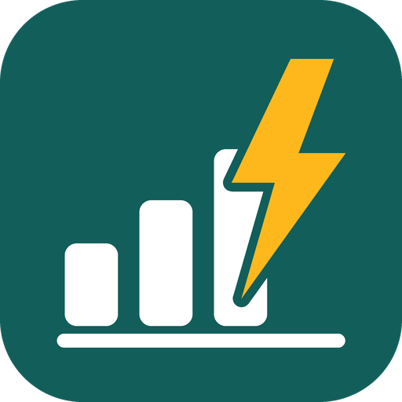

<p align="center">
  
</p>

# Glow History Import for Home Assistant

Brings your UK smart meter data from **Hildebrand Glow** (the service behind the free **Bright** app) into Home Assistant's **Energy Dashboard**, with accurate daily, weekly, monthly and yearly usage and cost.

[](https://hacs.xyz/docs/faq/custom_repositories)

## Why this exists

Smart meter data reaches Glowmarkt through the national DCC network, usually **one to two days late**. Integrations built around "usage today" sensors miss that data entirely, so the Energy Dashboard stays empty or shows zero.

This integration works differently. It re-reads the last few days every run and writes each half-hour of usage into **long-term statistics** at the time it actually happened. Late data simply fills in when it arrives.

## Features

- Electricity and gas consumption (kWh) and cost (GBP) for the Energy Dashboard
- Imports up to about 13 months of history on first setup
- Cost calculated from **your own tariff** (unit rate plus daily standing charge), editable at any time
- Automatically picks up late or corrected readings
- Status sensors showing how up to date your data is
- `glow_history.import_now` action to refresh on demand
- No extra hardware needed

## Requirements

- Home Assistant **2026.3** or newer
- A SMETS2 (or DCC-connected SMETS1) smart meter
- A free [Bright](https://glowmarkt.com) account with your meter linked and data visible in the app

## Installation

### HACS (recommended)

1. HACS → three-dot menu → **Custom repositories**
2. Add `https://github.com/binaryboyz/ha-glow-history` with category **Integration**
3. Search for **Glow History Import**, download it, and restart Home Assistant

### Manual

Copy `custom_components/glow_history` into your Home Assistant `config/custom_components/` folder and restart.

## Setup

1. **Settings → Devices & services → Add integration → Glow History Import**
2. Sign in with your **Bright** email and password
3. Click **Configure** and enter your tariff (pence per kWh and pence per day, from your bill)

The first import runs in the background and can take 5 to 10 minutes. The **Last import** sensor shows a time when it's done.

> **Important:** the default rates are only an example. Set your own, or your costs will be wrong.

## Energy Dashboard

**Settings → Dashboards → Energy**

| Section | Consumption | Cost ("Use an entity tracking the total costs") |
|---|---|---|
| Electricity grid | Glow Electricity consumption | Glow Electricity cost |
| Gas | Glow Gas consumption | Glow Gas cost |

These are statistics rather than entities, so they appear in the Energy Dashboard pickers and under **Developer tools → Statistics**, not in your entity list.

## Settings

| Option | Default | Notes |
|---|---|---|
| Electricity / gas unit rate | example values | p/kWh |
| Electricity / gas standing charge | example values | p/day |
| Include standing charges in cost | On | Turn off to see usage cost only |
| Check for new data every | 3 hours | |
| Re-check the last | 7 days | Late data within this window is picked up |
| History to import on first run | 395 days | Only used once |

When your tariff changes, update it here. New rates apply from the start of the re-check window onwards; older history keeps its original price. On first setup, all imported history is priced at the rates you enter.

## Troubleshooting

- **Latest day or two missing:** normal. The data hasn't reached Glowmarkt yet and will fill in.
- **"Data available up to" shows Unknown:** check **Settings → System → Logs** for `glow_history`, then run the **Import now** action.
- **Debug logging:**
  ```yaml
  logger:
    logs:
      custom_components.glow_history: debug
  ```
- **Start over:** remove the integration, delete the four `glow_history:` entries in **Developer tools → Statistics**, then add it again.

## Disclaimer

This is an unofficial community project. It is not affiliated with or endorsed by Hildebrand Technology, Glowmarkt, or any energy supplier. It uses the Glowmarkt API with your own Bright credentials, which are stored only in your Home Assistant configuration.

## Licence

[MIT](LICENSE)
